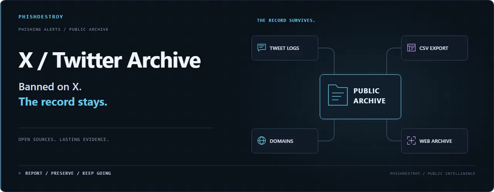
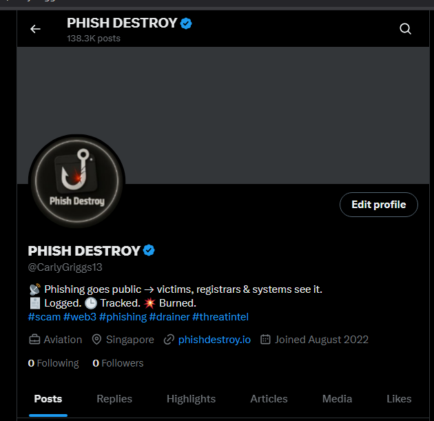
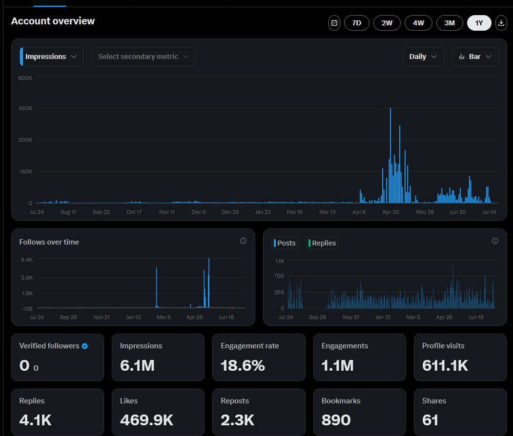
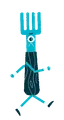

# 🕸️ X/Twitter Archive — CarlyGriggs13

  <picture><source media="(max-width:600px) and (prefers-reduced-motion:reduce)" srcset="assets/archive-readme/hero-mobile-poster.webp" /><source media="(prefers-reduced-motion:reduce)" srcset="assets/archive-readme/hero-poster.webp" /><source media="(max-width:600px)" srcset="assets/archive-readme/hero-mobile.webp" /></picture>
  
<strong>138,000+ phishing alerts published. Account banned. Surviving evidence preserved here.</strong>

## 📡 The work continues

**Reddit is back. Mastodon is live. Our main X account is still locked.**

We exposed NameSilo. Then our main X account, **@Phish_Destroy**, was locked. We've received **three appeal approvals** saying **“NO VIOLATION”** and promising restored access. **Three approvals. Still locked.**

<strong>More channels & public data</strong>

| Platform   | Link / dataset                                              |
|------------|----------------------------------------------------------|
|   Alternate X | [@AmberMille78556](https://x.com/AmberMille78556)        |
|   Telegram| [@destroy_phish](https://t.me/destroy_phish)   |
|   Database | [`list.json`](https://github.com/phishdestroy/destroylist/blob/main/list.json) |

  
  

##   Account Terminated 

<strong>View screenshot · @CarlyGriggs13 before takedown</strong>

 @CarlyGriggs13 before takedown

The account was mass-reported and banned by scam networks.  
No export, no appeal, no warning — full data wipe.

-   138,000+ tweets destroyed  
-   2,000–3,000 phishing domains exposed monthly  
-   No recovery, no archive tools  
-   Twitter silently deleted entire feed

<strong>View screenshot · Tweet volume before suspension</strong>

 Tweet volume before suspension

  

##   Archive Contents

| File / Folder              | Description                                                  |
|----------------------------|--------------------------------------------------------------|
| [`CarlyGriggs13_tweets.csv`](CarlyGriggs13_tweets.csv) | Last 3,500 tweets (structured CSV export)                   |
| [`domains.json`](domains.json)             | Collected phishing domains from tweets                      |
| [`webarchive.json`](webarchive.json)          | Archived tweet URLs via WebArchive                          |
| [`tweets_with_screenshots.txt`](tweets_with_screenshots.txt) | Preserved tweet records with screenshot references |
| [`tweetfeed/`](tweetfeed/)               | Raw tweet logs (approx. 1 month)                            |
| [`screen.png`](screen.png)               | Screenshot of suspended account                             |
| [`screen2.png`](screen2.png)              | Screenshot with tweet activity stats                        |
| [`img.png`](img.png)                  | Repo banner image                                           |

##   CSV Export

⬇️ [`CarlyGriggs13_tweets.csv`](./CarlyGriggs13_tweets.csv) — structured export of last 3,500 tweets.  
Includes tweet ID, timestamp, body text, and links. Suitable for filtering, analysis, and processing.

  

##   Message to Scam Networks   

  

You banned a name. We published ten more.  
You think Twitter bans stop takedowns? No.

Phishing sites aren’t blocked because of us.  
They’re blocked because of **your phishing**.  
Our system just makes it happen **faster**.

Taking down our Twitter changes nothing.  
Your scam domains are still getting banned.  
That’s not a threat — that’s a guarantee.

##   Legal Notice

- All data is public, OSINT-based, and threat-related only  
- No personal or private information is present  
- This archive is published for research, evidence, and digital preservation

  
  &nbsp;&nbsp;&nbsp;&nbsp;&nbsp;
  

  

